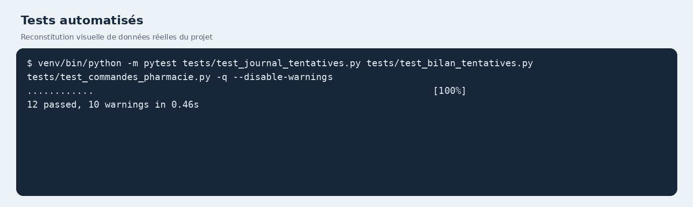
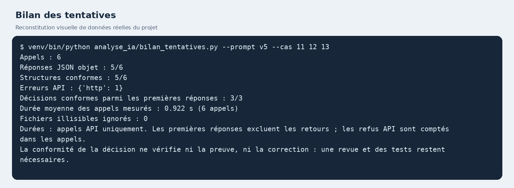
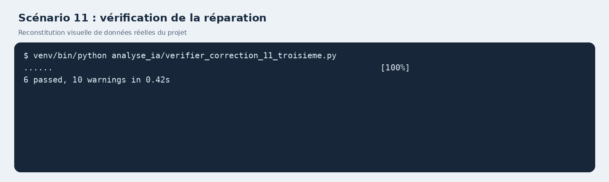
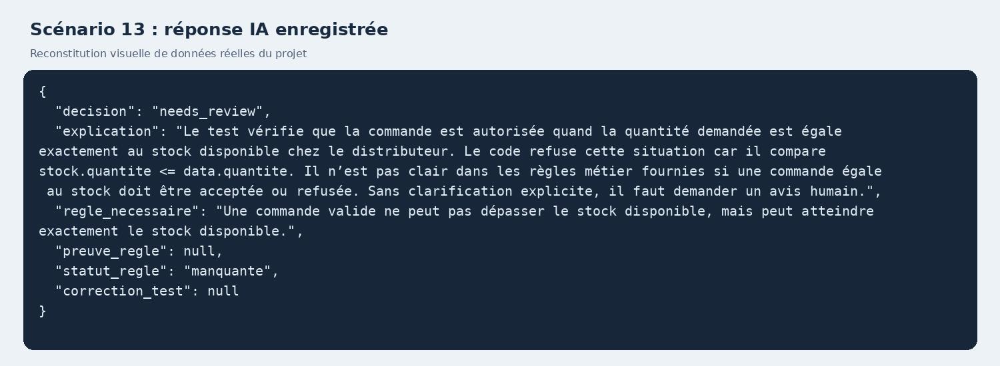

# Rapport de projet — Réparation de tests assistée par IA

**Binôme :** Adam Ellouz et Maher Ben Ammar  
**Classe :** GI3 S4  
**Sujet :** Réparation automatique de tests assistée par IA

Les résultats décrits correspondent aux essais enregistrés ; ils ne constituent pas une garantie de performance générale.

## 1. Contexte et objectif

Les tests automatisés peuvent échouer après une évolution d'un logiciel. Un échec peut provenir d'un test devenu obsolète, d'un défaut réel ou d'un manque d'information. L'objectif du projet est d'utiliser un modèle de langage pour analyser ces situations, proposer une décision et évaluer cette décision, en portant une attention particulière aux corrections qui pourraient masquer un défaut.

Le système sous test est une application existante de gestion de médicaments, avec un backend Python/FastAPI et une interface React. Son utilisation a été approuvée par l'enseignante. Le périmètre de l'expérience porte sur certaines fonctions du backend associées aux commandes et à leur réception.

## 2. Approche et outils

La suite utilise pytest et une base SQLite temporaire en mémoire. Elle appelle directement les fonctions du backend : l'interface HTTP et l'authentification complète ne sont pas couvertes par ces essais. Les modifications expérimentales sont réalisées sur des copies temporaires ; l'application active et sa base PostgreSQL ne sont pas modifiées pendant ces scénarios.

Un script prépare une version modifiée, exécute les tests, collecte le message d'échec, produit un diff avec Python et transmet ces informations, le test, le code pertinent et les règles disponibles à un modèle via l'API Groq. Le modèle utilisé dans les essais décrits est `openai/gpt-oss-20b`. Les réponses sont demandées en JSON avec une décision : `repair_test`, `report_bug` ou `needs_review`.

Les corrections générées ne sont pas appliquées automatiquement : elles sont examinées puis, pour certains cas, rejouées manuellement à l'aide de scripts dans un environnement temporaire. Les retours à l'IA sont également déclenchés manuellement. Le dépôt contient les versions et les réponses, mais le diff de l'expérience est actuellement produit par Python, et non automatiquement par Git.

## 3. Cas et références

Des scénarios synthétiques ont été définis à partir du code. Les scénarios 01 et 02 ont servi aux premiers essais ; 07 à la mise au point de la gestion de l'incertitude ; les réponses sur 08 à 10 ont contribué à améliorer le format du prompt. Les scénarios 11 à 13 ont ensuite été préparés pour évaluer la version v5, avec leurs décisions de référence définies avant les appels :

| Scénario | Changement | Référence |
| --- | --- | --- |
| 11 | Renommage approuvé d'un champ de requête | Réparer le test |
| 12 | Suppression du filtre qui limite la liste aux commandes de la pharmacie | Signaler un bug |
| 13 | Refus d'une quantité égale au stock, sans règle précisant ce cas | Demander une revue humaine |

Les scénarios ambigus utilisent une variante de prompt qui ne présume pas l'approbation de l'évolution. Il faut tenir compte de cette différence lors d'une comparaison. Les références, hypothèses et modifications sont documentées dans les dossiers de scénarios.

## 4. Résultats observés

Pour la série enregistrée v5 sur les cas 11 à 13, le bilan automatique indique :

- six appels API au total, y compris les retours et une erreur HTTP liée au quota ;
- cinq réponses JSON sur six appels et cinq structures conformes sur six appels ;
- trois décisions conformes sur trois premières réponses JSON reçues pour les scénarios 11 à 13 ;
- une durée moyenne d'appel mesurée de 0,922 seconde sur ces six appels.

La durée couvre seulement les appels API : elle n'inclut ni la préparation des scénarios, ni l'attente entre les appels, ni l'évaluation ou la correction humaine. La décision correcte ne prouve pas que la correction est correcte. Les refus et tentatives après retour sont inclus dans les comptes d'appels, mais exclus de la comparaison des premières décisions. Le résultat est descriptif et porte sur un très petit échantillon.

### Étude du scénario 11

La première réponse classe correctement le cas comme une réparation de test, mais sa correction ne modifie aucune ligne utile. Après un retour humain sur cette proposition, une deuxième correction est rejouée : cinq tests passent et un échoue. Après transmission de l'échec restant, une troisième proposition est combinée avec la deuxième : six tests passent et les assertions sont conservées. Les scripts et les journaux permettent de revoir ces étapes. Cette expérience illustre l'utilité d'un retour d'exécution et le coût de la revue humaine ; elle ne prouve pas une réparation entièrement automatique.

### Étude de l'incertitude

Pour le scénario 07, la règle sur le statut initial n'est pas fournie. Les prompts v2 et v3 proposent de modifier le test ; v4 demande une revue humaine. Ce cas ayant servi à ajuster le prompt, il ne constitue pas une évaluation indépendante. Dans le cas 13, préparé ensuite, v5 demande également une revue humaine. Un seul cas de ce type reste insuffisant pour généraliser.

## 5. Limites et discussion

- Plusieurs scénarios sont synthétiques et proches les uns des autres ; les résultats ne mesurent pas la performance sur des évolutions réelles et variées.
- Les règles fournies à l'IA influencent fortement la décision. Une règle non fournie ne prouve pas qu'elle n'existe pas.
- Les réponses peuvent être mal structurées ou inclure une explication incohérente. Une citation présente dans la consigne n'est pas automatiquement pertinente.
- Les durées enregistrées ne couvrent pas le travail humain. Aucune comparaison chronométrée avec une réparation manuelle complète n'a encore été réalisée.
- La disponibilité et les quotas d'API affectent l'exécution. Les fichiers de journal enregistrent les appels récents, tandis que les premiers essais n'ont pas tous des traces complètes.
- Les appels transmettent du code au fournisseur : vérifier les droits, les données et les secrets avant tout envoi ou partage du dépôt.

## 6. Reproductibilité et travail restant

Les étapes d'installation et de lancement figurent dans `analyse_ia/README.md`. Une installation des dépendances et les tests ont été vérifiés sur un environnement Python neuf sous Linux ; l'application complète et l'appel à l'API n'ont pas été vérifiés dans cet environnement neuf. Le dépôt Git et les modifications présentes doivent être vérifiés avant partage ; le code contient des configurations sensibles potentielles qui ne doivent pas être publiées sans revue.

Pour poursuivre : ajouter davantage de cas indépendants et de changements réels, mesurer le temps de traitement complet et le temps humain sur les mêmes cas, comparer à une référence manuelle, puis étudier une application contrôlée et automatisée des corrections après validation.

## 7. Illustrations des résultats

Les images ci-dessous sont des **reconstitutions visuelles de sorties et de données réellement enregistrées** ; elles ne sont pas des captures directes de l'écran du terminal. Elles ne contiennent pas de clé API.

### Tests automatisés

### Bilan des appels

### Vérification de la réparation du scénario 11

### Réponse de l'IA pour un cas ambigu

## 8. Références

1. Enseignante du cours, *Projets de test logiciel assistés par l'IA — Catalogue de sujets, 3ᵉ année Génie Informatique*, document pédagogique fourni. Les consignes indiquent les livrables minimaux et la grille d'évaluation proposée.
2. pytest, [Get Started](https://docs.pytest.org/en/stable/getting-started.html), documentation officielle sur la création et l'exécution de tests.
3. FastAPI, [Documentation](https://fastapi.tiangolo.com/), documentation du framework utilisé pour le backend.
4. SQLAlchemy, [SQLite — In-memory database](https://docs.sqlalchemy.org/en/20/dialects/sqlite.html), documentation sur la base de données temporaire utilisée dans les tests.
5. Groq, [Text Generation](https://console.groq.com/docs/text-chat), documentation de l'API de génération de texte.
6. Groq, [Structured Outputs](https://console.groq.com/docs/structured-outputs), documentation sur les réponses JSON. Le projet utilise le mode JSON objet et effectue ses propres contrôles ; il n'utilise pas la garantie de schéma strict.
7. Git, [Documentation](https://git-scm.com/doc), documentation de l'outil de gestion de versions. Le diff transmis dans cette expérimentation est actuellement construit avec Python.
8. Binôme, journaux et scénarios du projet : dossiers `analyse_ia/` et `scenarios/`, comprenant les prompts, les réponses et les références d'évaluation.

## Annexe — Comparaison des approches

La branche multi-agents comprend une comparaison détaillée des résultats à un modèle et multi-agents dans [comparaison_approches.md](comparaison_approches.md). Les résultats multi-v3 sont expérimentaux et ne remplacent pas les résultats de la version à un modèle présentés ci-dessus.
